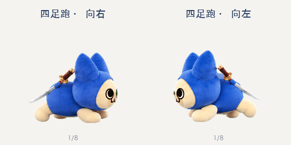
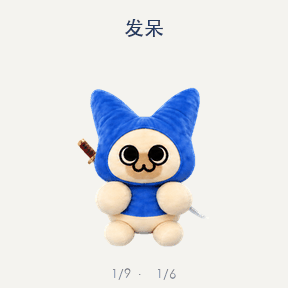
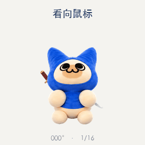

# 呆猫 · 圆团太刀

以《怪物猎人：崛起》的呆猫外观为基础，制作了一套 ChatGPT 宠物动画，包含跑步、挥手、跳跃等九种动作和十六个转头方向。

这是为 ChatGPT 宠物制作的成品素材包，已在制作时完成客户端创建。本目录不含账号绑定信息，也不是双击即可运行的独立桌面宠物程序。

## 看看动作

### 四足小跑

### 九种动作

| 状态 | 预览 | 帧数 |
| --- | --- | --- |
| 待机 | [idle](previews/idle.gif) | 6 |
| 向右跑 | [running-right](previews/running-right.gif) | 8 |
| 向左跑 | [running-left](previews/running-left.gif) | 8 |
| 挥手 | [waving](previews/waving.gif) | 4 |
| 跳跃 | [jumping](previews/jumping.gif) | 5 |
| 失败反应 | [failed](previews/failed.gif) | 8 |
| 等待 | [waiting](previews/waiting.gif) | 6 |
| 工作中 | [running](previews/running.gif) | 6 |
| 检查成果 | [review](previews/review.gif) | 6 |

### 十六个转头方向

## 文件与使用

- [daimao-v2.png](daimao-v2.png)：最终透明 PNG 精灵图集，1536 × 2288 像素。
- [spritesheet.json](spritesheet.json)：图集布局。8 列、11 行，单格 192 × 208 像素，共 73 个有效帧；每行未使用的格子不是动画帧。
- `previews/`：可直接在浏览器中查看的 GIF，不需要安装依赖、启动服务器或登录账号。

只想看效果，打开上面的动画即可。要制作自己的宠物或接入播放器，下载 PNG 和布局文件，并按目标客户端实际支持的自定义宠物流程导入。若客户端没有导入入口，仅下载图集不会自动安装宠物；这里不提供账号接口、登录凭据或一键安装脚本。

## 制作记录

围绕呆猫外观制作各动作与转头姿态，保持形象一致，再组装成图集。最后处理透明边缘并重新导出 GIF，修正低透明度残色变成实色边的问题。

收录的是去色边终稿，未混入早期版本。部分相邻转头角度仍较接近。

## 来源与公开范围

形象来源为《怪物猎人：崛起》的呆猫外观，动画使用 AI 辅助制作，属于非官方作品。制作时的参考记录：[布偶照片与动作参考](https://www.bilibili.com/opus/846584757521219604)。本仓库不转载原始参考图片或视频；动作并非游戏动画的逐帧复刻。

本目录收录成品图集、预览和布局说明。第三方角色与素材授权尚未核实，不声称获得官方授权，也不提供统一素材许可证。
